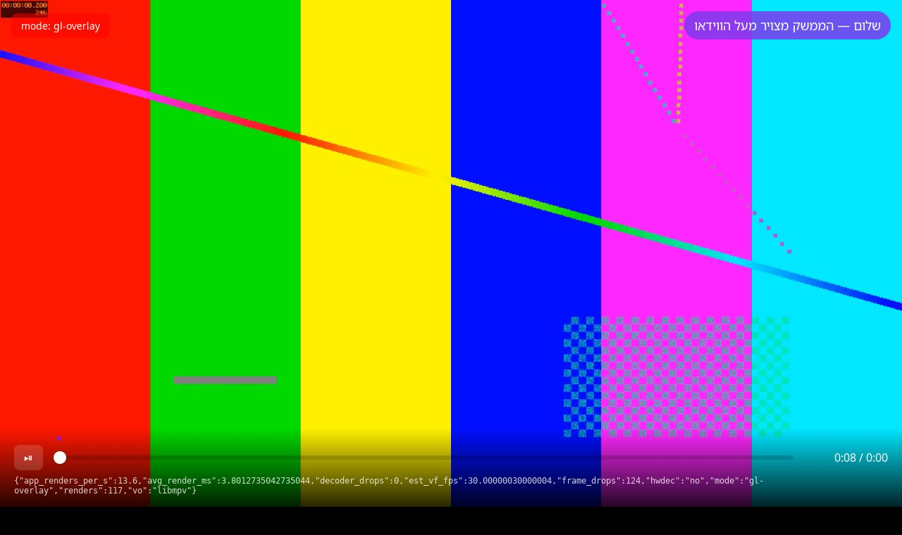
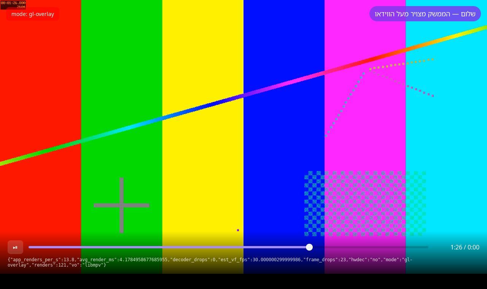
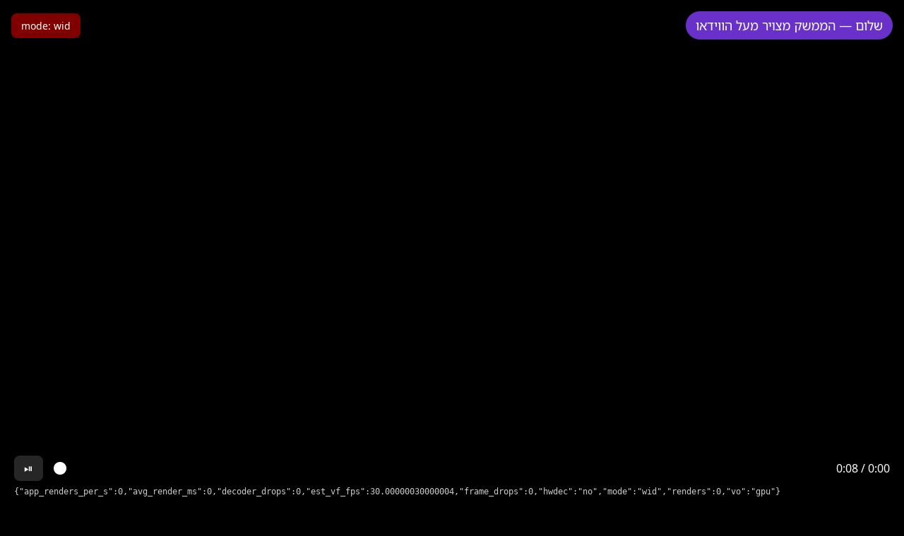
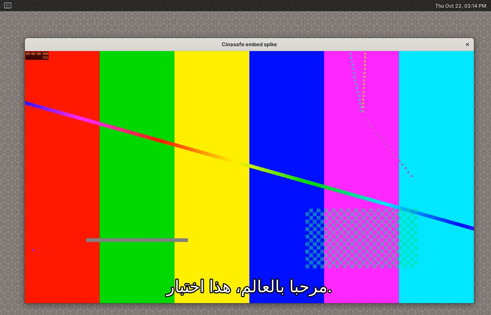
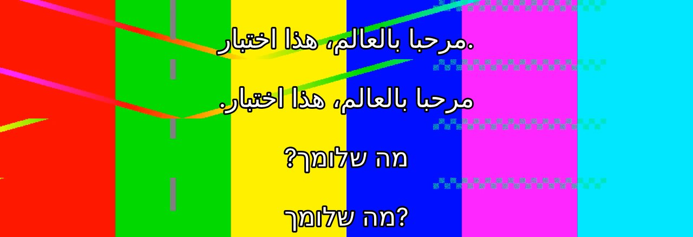

# Milestone 0: playback and embedding spike

Status: **architecture holds on Linux X11; Wayland and Windows still need checks on real hardware.**
Date: 2026-10-22. Environment: Ubuntu 24.04 container, 4 vCPU, no GPU (Mesa llvmpipe),
libmpv 0.37 (client API 2.2), WebKitGTK 2.52, Tauri 2.12, Xvfb and headless Weston 13.

Reproduce: `spike/run-spike.sh` (headless) and `spike/run-spike.sh --window` (needs a display).
Test media is synthetic (ffmpeg `testsrc2`). Subtitles are a hand-written Hebrew/Arabic/English SRT.

## Against the M0 acceptance criteria (brief section 14)

| Criterion | Status |
| --- | --- |
| Encrypt one video with a minimal blob writer; play it through `cinasafe://` in libmpv embedded in a Tauri 2 window with an HTML overlay button that pauses it | **Met on Linux X11.** The full blob format (not just a minimal writer), libmpv through `cinasafe://`, and video under the HTML controls in one window. Clicking the HTML seek bar was verified with a screenshot. The ⏯ button sends `cycle pause` through the same command path. |
| Works on Windows 11, Ubuntu (Wayland) and Ubuntu (X11), or a documented fallback per 6.3 works | **Partly.** X11 works. Wayland: video works, but the web layer can't be checked in this container. Windows: code and installer build in CI, never run. Both need a real machine. |
| Seeking to 10 random points in a 4K file each completes in under 1 s from a USB 3 stick | **Met in simulation.** A 40 Mb/s 2160p file through a throttled 80 MiB/s, 2 ms/read source took at most 268 ms over 10 seeks. Even at USB 2-class 25 MiB/s the worst was 545 ms. Confirm with a real stick. |
| `docs/SPIKE.md` records approach, results and decisions | Met (this file). |

Go/no-go: **go for Linux**. Hold Windows and Wayland sign-off until someone runs the steps
below on real hardware.

## What the spike asked

1. Can mpv play media straight out of the encrypted blob format, from memory only, fast enough
   to seek instantly on a USB stick? (brief sections 4.4, 5.2, 6.1)
2. Can the video appear inside the Tauri window, with the web UI drawn on top? (6.3)
3. Does any of it write to the host disk? (section 0)

## 1. Encrypted stream bridge: works

`cinasafe-core` implements the `.cblob` format exactly as in brief 4.4. `cinasafe-player` registers
`cinasafe://` with `mpv_stream_cb_add_ro`. mpv's `read` and `seek` map onto `BlobReader`, which
decrypts 1 MiB chunks on demand, keeps 16 in a zeroizing LRU and prefetches 2 ahead.

| Measurement (release build) | 1080p H.264 MKV, 8 Mb/s | 2160p H.264 MP4, 40 Mb/s |
| --- | --- | --- |
| Encrypt on import (incl. fsync) | 184 MiB/s | 120 MiB/s |
| `BlobReader` sequential decrypt, page cache warm | 670 MiB/s | 693 MiB/s |
| Random 64 KiB read after seek (decrypts one 1 MiB chunk) | median 1.6 ms | median 1.4 ms |
| `loadfile` → playing, no throttle | 74 ms | 102–147 ms |
| Seek → playback restart, no throttle | median 74 ms, max 121 ms | median 164–181 ms, max 276 ms |
| Seek, **simulated 25 MiB/s stick + 2 ms/read**, 16 MiB demuxer cache | median 129–137 ms, p90 192 ms | median 332–339 ms, p90 545 ms |
| Seek, simulated 80 MiB/s stick + 2 ms/read | median 78–100 ms, p90 147 ms | median 178–225 ms, p90 268 ms |
| Dropped frames (headless, `vo=null`) | 0 | 0 |

- Crypto is not the bottleneck: decryption runs 5–25× faster than USB 2.0/3.0 sticks read.
- The "slow stick" runs used the real file wrapped in a throttled `ChunkSource`, with the demuxer
  cache shrunk so mpv actually seeks the stream rather than its RAM cache. Real movies are far
  bigger than the 256 MiB cache, so this is the realistic case.
- The bridge measures read throughput as mpv sees it (`StreamStats`). That feeds the
  "this stick may be too slow" notice (6.4). Under throttling it reported 23–27 MiB/s for a
  25 MiB/s cap, which is accurate.
- Text subtitles inside the MKV and the external `cinasafe://` SRT both load. Hebrew and Arabic
  text comes through intact (`sub-text`).

## 2. Embedding mpv in the Tauri window

Code: `spike/tauri-embed`. On Linux, Tauri's GTK window holds a `GtkBox` with the WebKit webview.
The spike swaps that for a `GtkOverlay`. The base child shows video, and the transparent webview
sits above it as the overlay child, so the web UI gets all input.

| Platform | Option 1: native child window + `wid` | Option 2: mpv render API (OpenGL) under transparent webview | Option 3: separate mpv window + transparent controls window |
| --- | --- | --- | --- |
| Linux X11 | **Fails.** See below. | **Works.** Screenshot below. | Implemented, not screenshot-tested (Xvfb has no compositor) |
| Linux Wayland | Not possible (no XIDs) | **Video works.** Web layer unverified in this container, see below | Not viable: Wayland clients can't position windows |
| Windows 10/11 | Implemented (`src/win.rs`), type-checks, **untested** | Not attempted | Implemented, untested |

### Linux X11, option 2: works

The mpv render API draws into a `GtkGLArea`, with WebKit's background set to fully transparent
above it. The purple pill, the red mode badge and the controls bar are HTML. The test pattern
behind them is mpv. Clicking the HTML seek bar at 70% seeked mpv to 1:26:

mpv's subtitle rendering is visible through the transparent page. It shows mixed
Hebrew/English shaping correctly (first screenshot run).

### Linux X11, option 1: fails, by design of X11/GDK

mpv creates its window inside the native child (`xwininfo` shows it), but the video is never
visible. GDK clips native child windows out from under client-side widgets stacked above
them, and the webview covers the whole area. X11 also cannot alpha-blend one child window over
another, so no z-order trick would show the video *through* a transparent webview.
Conclusion: on Linux use option 2 on both X11 and Wayland.

### Linux Wayland, option 2: video works; web layer unverified here

Under headless Weston the `GtkGLArea` path renders video and subtitles at the right size. The
web layer is missing, but **an unmodified Tauri webview also draws nothing in this container**.
WebKitGTK's web process can't create an EGL display without a DRM device ("failed to get driver
name for fd -1"). That holds with `WEBKIT_DISABLE_DMABUF_RENDERER=1` and
`WEBKIT_DISABLE_COMPOSITING_MODE=1` too, and on both Weston's GL and pixman renderers. GTK3
composites the overlay client-side the same way on Wayland as on X11, so I expect option 2 to
work. It must be checked on real GNOME and KDE Wayland sessions before Milestone 1 builds on it.

Found along the way: passing the `wl_display` to mpv (`MPV_RENDER_PARAM_WL_DISPLAY`, needed for
VAAPI interop) **segfaulted inside `vaInitialize`** when no GPU is present. The app must only
pass native display handles when a DRM render node exists, or accept software decoding.
(`CINASAFE_SPIKE_NO_NATIVE_DISPLAY=1` skips it in the spike.)

### Windows: written, not run

`src/win.rs` creates a disabled `STATIC` child HWND at the bottom of the z-order and passes it
to mpv as `wid`. The WebView2 child sits above it with a transparent background (Tauri
`transparent: true`). This type-checks for `x86_64-pc-windows-msvc` but has not been run.
To check on a Windows 10 and 11 machine:

1. Build: `cargo build -p tauri-embed-spike -p cinasafe-cli --release`.
2. Put `libmpv-2.dll` (an mpv "dev" build for x86_64) next to the exe. The player loads it at
   runtime, so the build itself needs no mpv SDK.
3. `cinasafe spike-init D:\` then `cinasafe spike-import D:\ movie.mkv` to get a blob id.
4. Set `CINASAFE_SPIKE_ROOT=D:\` and `CINASAFE_SPIKE_BLOB=<id>`, then run
   `tauri-embed-spike.exe`. Try `CINASAFE_SPIKE_MODE=separate` as well.
5. Check: is the video visible under the HTML controls? Do clicks reach the HTML? Does
   resizing/fullscreen keep the video filling the window? Do DPI scaling and multi-monitor
   moves work?

If WebView2 does not blend over a sibling HWND, the next things to try are the mpv render API
into a D3D11/ANGLE surface, or option 3.

### Option 3 trade-offs (fallback)

It only works where the app can position its own windows (X11, Windows), and on X11 it needs a
compositing window manager for the transparent controls window. Two windows also bring
focus/alt-tab/taskbar oddities, and keeping them glued during moves and fullscreen is fiddly.
Use it only if option 1 fails on Windows.

### Rendering performance: not measurable here

This container has no GPU, so the numbers below are llvmpipe artefacts and say nothing about
real hardware:

- With mpv's default quality settings, llvmpipe took ~160 ms per frame and showed **black
  video** (subtitles still drew). With `profile=fast`, rendering took 2–4 ms per frame, and the
  GTK side then capped presentation at ~15–28 fps.
- Recommendation: if mpv reports a software renderer, switch to `profile=fast`. Measure 1080p60
  and 2160p on real Intel/AMD/NVIDIA machines during Milestone 1. GTK3 composites `GtkGLArea` through
  cairo, which can mean a GPU→CPU readback per frame on some setups. That is the main
  performance risk of option 2 at 4K.

## 3. Host-disk writes

`strace` over every `open`, `creat`, `rename`, `unlink` and `mkdir`:

| Run | Writes to the host disk |
| --- | --- |
| Headless player (`cinasafe spike-play`, libmpv + bridge + subtitles + 5 seeks) | **None.** No successful write-mode opens. |
| Tauri app, `incognito: true` | `~/.local/share/<identifier>/` (WebKit salts, `hsts-storage.sqlite`, `WebKitCache/`) and `~/.cache/mesa_shader_cache/` |
| Tauri app with `XDG_DATA_HOME`/`XDG_CACHE_HOME` redirected and `MESA_SHADER_CACHE_DISABLE=true` | **None** (everything landed in the redirect directory) |

None of these files hold titles, media or library data, but they do show that Cinasafe ran on
the machine. Tauri's `incognito` does not stop WebKit creating its data directory. Proposal in
`OPEN_QUESTIONS.md`: point WebKit/WebView2 data directories at a RAM directory
(`$XDG_RUNTIME_DIR` on Linux) or the stick, and disable the Mesa shader cache.

## 4. Subtitles: one finding for section 7.2

Rows from top: Arabic line with mpv defaults; same line with
`sub-ass-style-overrides=Encoding=-1`; legacy Hebrew line `?מה שלומך` with defaults; same with
`Encoding=-1`.

- By default libass lays out every line left-to-right, so a correctly written Arabic or Hebrew
  sentence gets its final full stop on the wrong side (row 1).
- `Encoding=-1` makes libass detect the base direction per line, which fixes correctly written
  RTL subtitles (row 2).
- Legacy files that pre-flip punctuation for LTR players (`?מה שלומך`) then look wrong (row 4).
  That is exactly the case the brief's "Fix RTL punctuation" option exists for. With
  `Encoding=-1` the fix only needs to move leading punctuation to the end. The RLE/PDF wrap
  stays harmless.

## Verdict and recommendation

- The core premise holds. Decrypted bytes go from the stick through `BlobReader` into libmpv
  over `cinasafe://`, never touching the host disk, and are fast enough for instant seeking on
  slow sticks.
- Linux: adopt option 2 (mpv render API → `GtkGLArea` under a transparent WebKit view) for X11
  **and** Wayland. Drop option 1 on Linux.
- Before Milestone 1 builds the player on this, check on real hardware:
  1. Option 2 on GNOME and KDE Wayland (web layer visible, input works).
  2. Option 1 on Windows 10 and 11 (steps above).
  3. Frame pacing at 1080p60 and 2160p with a real GPU, hwdec on and off.
